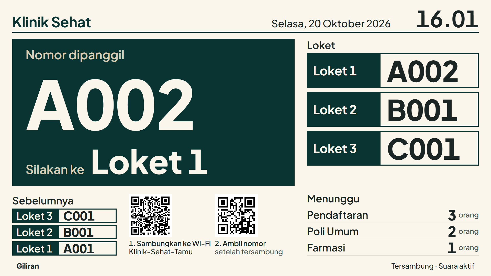
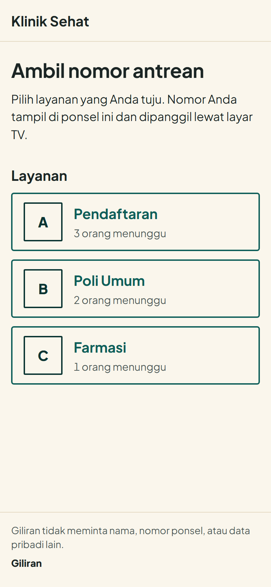
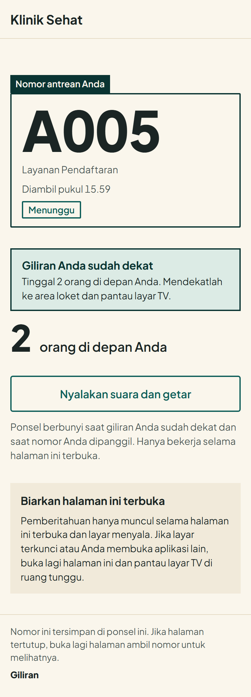
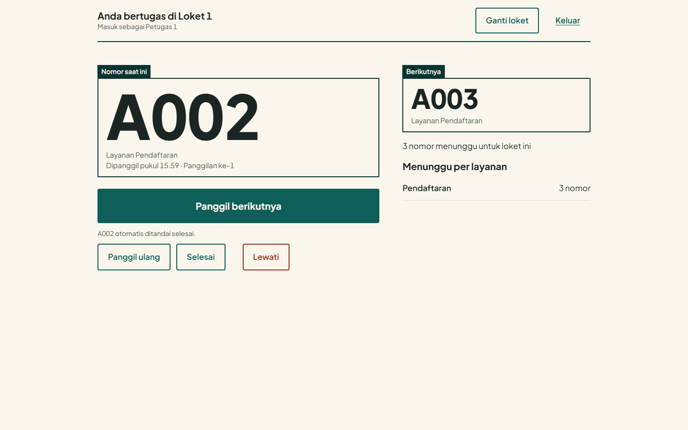
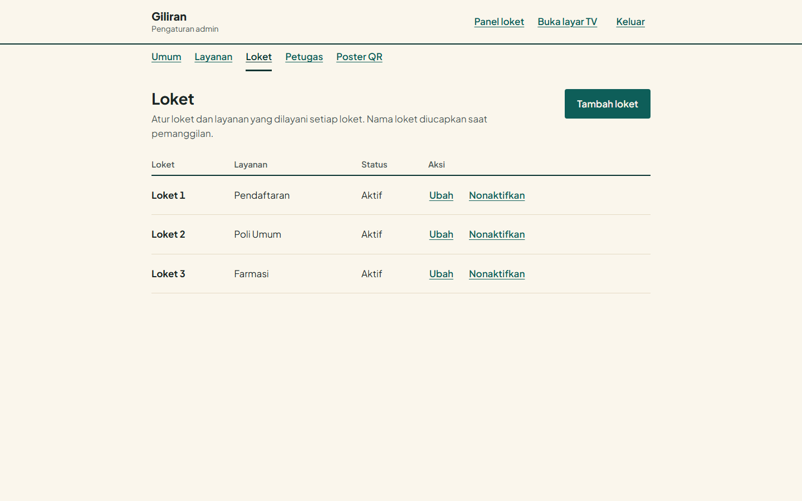
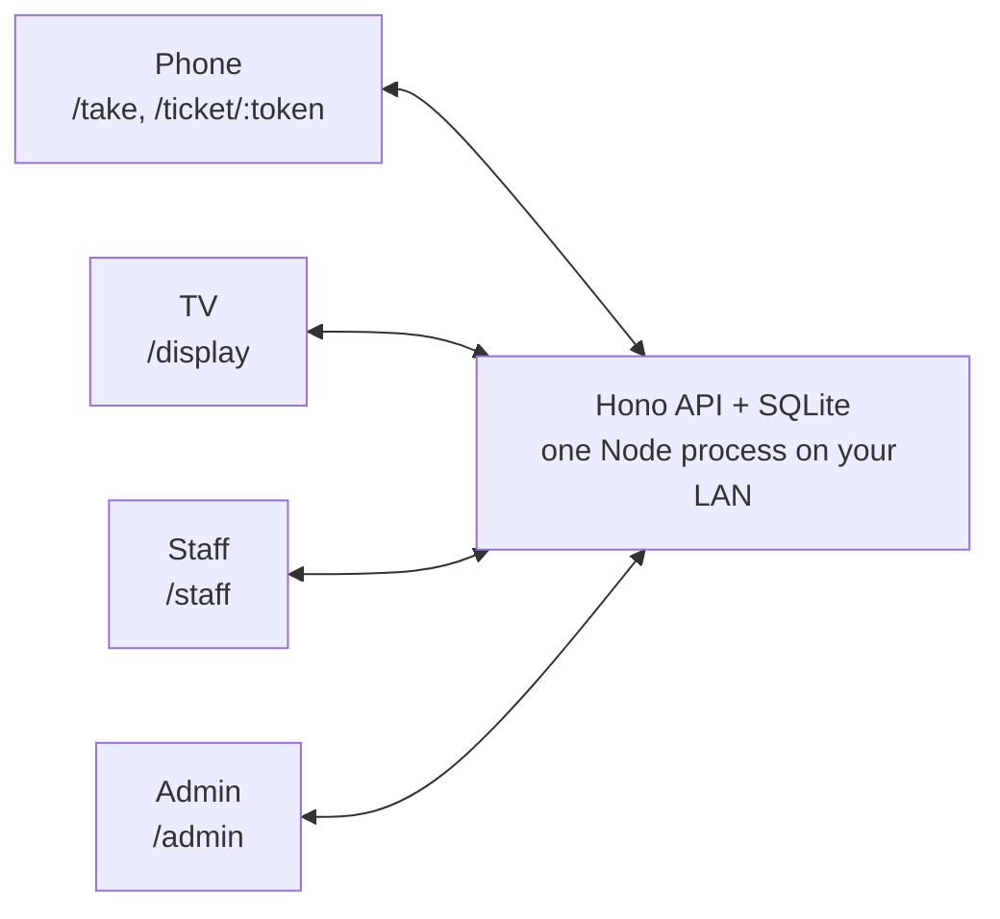

<h1 align="center">Giliran</h1>

<p align="center">
  A real-time queue system for one venue on a local network.<br>
  Visitors scan a QR code, a TV calls the numbers out loud, staff run the counters.
</p>

<p align="center">
  <a href="LICENSE"></a>
  
</p>



Giliran runs as one Node process with one SQLite file. There is no cloud service, no sign-up for visitors, and no personal data collected: visitors never enter a name or phone number. The interface is in Indonesian.

## Contents

- [Features](#features)
- [Screenshots](#screenshots)
- [How it works](#how-it-works)
- [Requirements](#requirements)
- [Quick start](#quick-start)
- [Configuration](#configuration)
- [Scripts](#scripts)
- [URLs](#urls)
- [Tests](#tests)
- [Project structure](#project-structure)
- [Tech stack](#tech-stack)
- [Limitations](#limitations)
- [Documentation](#documentation)
- [License](#license)

## Features

- Visitors scan the poster QR, pick a service and get a number on their phone. The ticket page updates live and shows how many people are ahead.
- The phone plays a chime, vibrates (Android) and shows a message when the turn is near and when the number is called. See [Limitations](#limitations).
- The TV in the waiting room shows the latest call, the counters, recent calls, the queue length per service and the QR code. Calls are spoken in Indonesian.
- Staff pick a counter, then call the next number, recall, skip or finish.
- The admin sets the business name, the timezone, services (each with a 1 to 3 letter number prefix), counters and staff accounts, and prints an A4 QR poster.
- The admin can enter the guest Wi-Fi once. The poster and the TV then show two QR codes: join the Wi-Fi, then take a number.
- Numbers restart at midnight in the business timezone.

## Screenshots

The screenshots use demo data (a clinic with three services and three counters).

<table>
  <tr>
    <td align="center" width="50%"><br><sub>Visitor picks a service (<code>/take</code>)</sub></td>
    <td align="center" width="50%"><br><sub>Live ticket (<code>/ticket/:token</code>)</sub></td>
  </tr>
</table>





## How it works



The server pushes changes to phones, the TV and staff panels with Server-Sent Events (SSE). Everything runs on the local network, so the TV, the phones and the staff devices must all reach the server's address.

## Requirements

- Node.js 24 or newer. Giliran runs TypeScript directly through Node's type stripping. The `dev`, `start` and `admin:create` scripts hide the experimental warning described below.
- npm.
- For the TV: a device with a current Chrome or Edge. See [docs/display-setup.md](docs/display-setup.md).

> [!NOTE]
> Giliran uses the built-in `node:sqlite` module, which is still marked experimental in Node 24.

## Quick start

For a quick look on one machine:

```bash
npm install
npm run admin:create     # asks for username, display name and password
npm run dev
```

Open http://localhost:5173/login, sign in, and open **Pengaturan admin** to add a service and a counter. Then open `/take` to take a number and `/display` for the TV view.

`npm run dev` starts Vite on port 5173 (with `--host`, so other devices on your network can reach it) and the API on port 3000. Vite proxies `/api` to the API, so in development every request reaches the API from 127.0.0.1 and all devices share one ticket limit (10 per 10 minutes) and one login limit. To test with several phones, use the build below.

For use on a real network, build and run a single process:

```bash
npm install
npm run build
npm run admin:create
npm start                # listens on 0.0.0.0:3000 by default
```

Then follow [docs/setup-lan.md](docs/setup-lan.md).

> [!IMPORTANT]
> The first admin can only be created with `npm run admin:create`. There is no web sign-up. After that, the admin adds staff accounts in the admin page.

## Configuration

Copy `.env.example` to `.env` and edit it. The scripts load `.env` when it exists. Variables already set in the shell work too.

| Variable | Default | Description |
|---|---|---|
| `PORT` | `3000` | Port the server listens on. Must be an integer from 1 to 65535. |
| `HOST` | `0.0.0.0` | Address the server binds to. The default accepts connections from the whole network. |
| `PUBLIC_URL` | `http://localhost:<PORT>` | The address phones use to reach the server. The poster and TV QR code points to `PUBLIC_URL` + `/take`. The API rejects state-changing requests whose `Origin` matches neither the request's `Host` nor `PUBLIC_URL`. Set it to the server's LAN address, for example `http://192.168.1.10:3000`. A trailing slash is removed. When it starts with `https://`, session cookies are marked `Secure`. |
| `DB_PATH` | `./data/giliran.db` | Path of the SQLite file. The folder is created if missing. |

`.env.example` ships with `PUBLIC_URL=http://192.168.1.10:3000`. Replace that address with your own.

## Scripts

| Command | What it does |
|---|---|
| `npm run dev` | Runs the API (with file watching) and Vite together. Web on 5173, API on 3000. |
| `npm run dev:api` | API only, with file watching. |
| `npm run dev:web` | Vite only, with `--host`. |
| `npm run build` | Type-checks, then builds the web app into `dist/web`. |
| `npm start` | Runs the server. It also serves the built web app from `dist/web`. |
| `npm run admin:create` | Creates an admin account. Prompts for username, display name and password. |
| `npm run typecheck` | `tsc --noEmit`. |
| `npm run lint` | ESLint. |
| `npm test` | Vitest: unit and integration tests. |
| `npm run test:e2e` | Playwright: builds the app, then runs browser tests against a server on port 3100. |

Pending database migrations are applied automatically when the server or `admin:create` starts.

## URLs

| Path | Who | What |
|---|---|---|
| `/take` | Visitor | Pick a service and take a number. The poster QR points here. |
| `/ticket/:token` | Visitor | The visitor's live ticket. |
| `/display` | TV | Queue display with voice announcements. |
| `/login` | Staff, admin | Sign in. |
| `/staff` | Staff, admin | Counter panel. |
| `/admin` | Admin | Settings, services, counters, accounts, QR poster. |
| `/api/health` | Anyone | Returns `{ "ok": true, "time": <ms> }`. Handy for checking that the server is up. |

## Tests

```bash
npm test
npm run test:e2e
```

Vitest runs `tests/unit` and `tests/integration`. Integration tests exercise the API against an in-memory database.

<details>
<summary>End-to-end tests (Playwright)</summary>

Playwright runs `tests/e2e` in Chromium. Each test starts a fresh server on port 3100 with its own database (`data/e2e.db`). The tests cover a visitor, a counter and the TV staying in sync, the recall, skip and done flow, recovery after a server restart, and admin setup. If Chromium is missing, run `npx playwright install chromium`.

</details>

## Project structure

```text
src/server/      Hono API, SQLite access, domain logic, SSE hub, daily rollover
  db/migrations/ NNN_name.sql migrations and NNN_name.down.sql manual rollbacks
  routes/        public, auth, staff, admin and stream endpoints
src/shared/      Request schemas and types shared by server and web (contracts.ts)
src/web/         React app: pages for take, ticket, display, login, staff, admin
scripts/         create-admin.ts
tests/           unit, integration and e2e (Playwright) tests
docs/            Guides (see Documentation)
```

## Tech stack

Node 24, Hono, Server-Sent Events, SQLite (`node:sqlite`), Zod, QR codes with `qrcode`, React 19, Vite, wouter, TypeScript, Vitest, Playwright.

## Limitations

> [!WARNING]
> Giliran runs on plain HTTP on a LAN. Without HTTPS, phones cannot receive push notifications. The chime, vibration and message work only while the ticket page is open and the screen is on. The TV voice is the reliable channel.

- Giliran serves one venue from one server. There is no multi-site support and no clustering, and the database is a local file.
- The TV needs a device running current Chrome or Edge. Built-in smart-TV browsers are not supported.
- The TV announces calls with the browser's Indonesian (`id-ID`) voice. Without that voice installed, only a chime plays.
- The QR code holds the server's address. If the server's IP changes, every printed poster stops working.
- The interface is Indonesian only.

## Documentation

- [Server setup on a LAN](docs/setup-lan.md): network, firewall, Wi-Fi QR, poster.
- [TV display setup](docs/display-setup.md): the device, sound and voice, kiosk mode.
- [Operations](docs/operations.md): daily use, backup and restore, migration rollback, upgrades, troubleshooting.

## License

MIT. See [LICENSE](LICENSE).
